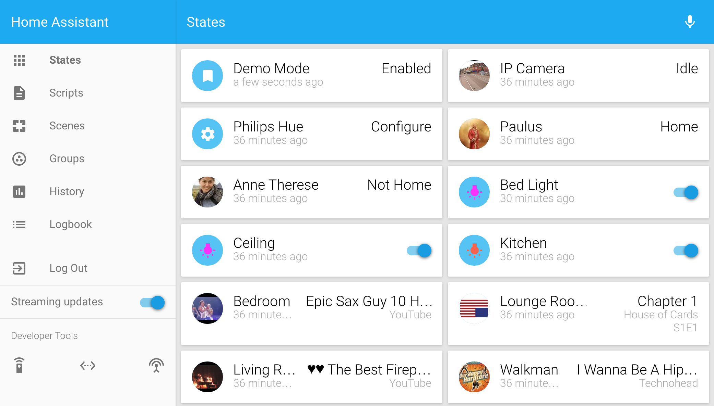

# Home Assistant Frontend

This is the repository for the official [Home Assistant](https://home-assistant.io) frontend.

[](https://demo.home-assistant.io/)

- [View demo of Home Assistant](https://demo.home-assistant.io/)
- [More information about Home Assistant](https://home-assistant.io)
- [Frontend development instructions](https://contributors.home-assistant.io/frontend/development/)

## Development

- Initial setup: `script/setup`
- Development: [Instructions](https://contributors.home-assistant.io/frontend/development/)
- Production build: `pnpm build`
- Gallery: `cd gallery && script/develop_gallery`

## Frontend development

### Classic environment

A complete guide can be found at the following [link](https://www.home-assistant.io/developers/frontend/). It describes a short guide for the build of project.

## Custom card color helpers

Custom cards can use the frontend's color helpers through `window.loadCardHelpers()`:

```javascript
const helpers = await window.loadCardHelpers();
helpers.computeCssVariableName("amber"); // "--amber-color"
helpers.computeCssColor("amber"); // "var(--amber-color)"
```

Both helpers leave custom CSS color strings unchanged. They return CSS variable
names or expressions, not resolved RGB values, so palette colors follow the active
theme. Cards supporting older frontend versions should check that the helpers are
available before using them.

## License

Home Assistant is open-source and Apache 2 licensed. Feel free to browse the repository, learn and reuse parts in your own projects.

We use [BrowserStack](https://www.browserstack.com) to test Home Assistant on a large variety of devices.

[](https://www.openhomefoundation.org/)
